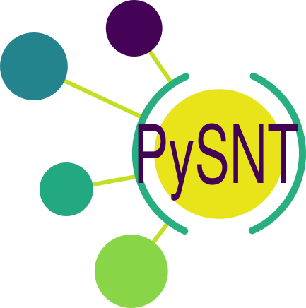

<p align="center"></p>
<h1 align="center">PySNT</h1>
<h2 align="center">Python wrapper for SNT, the framework for quantification of neuronal anatomy</h2>
<div align="center">
  <!-- PyPI -->
  <a href="https://pypi.org/project/pysnt/">
    
  </a>
  <!-- Python versions -->
  <a href="https://pypi.org/project/pysnt/">
    
  </a>
  <!-- Tests -->
  <a href="https://github.com/morphonets/pysnt/actions/workflows/ci.yml">
    
  </a>
  <!-- Code quality -->
  <a href="https://www.codefactor.io/repository/github/morphonets/pysnt">
    
  </a>
<br>
  <!-- License -->
  <a href="https://github.com/morphonets/SNT/blob/master/LICENSE.txt">
    
  </a>
  <!-- DOI -->
  <a href="https://doi.org/10.5281/zenodo.24090107">
    
  </a>
  <!-- Forum -->
  <a href="https://forum.image.sc/tags/snt">
    
  </a>
  <!-- Issues -->
  <a href="https://github.com/morphonets/pysnt/issues">
    
  </a>
  <a href="https://github.com/morphonets/pysnt/issues">
    
  </a>
</div>
<div align="center">
  <h3>
    <a href="https://pysnt.readthedocs.io/en/latest/install.html">
      Installation
    </a>
    <span style="margin:.5em">|</span>
    <a href="https://pysnt.readthedocs.io/en/latest/index.html">
       Documentation
    </a>
    <span style="margin:.5em">|</span>
    <a href="https://forum.image.sc/tag/SNT">
      Support
    </a>
  </h3>
</div>


> **Please read the [installation instructions](https://pysnt.readthedocs.io/en/latest/install.html) before installing PySNT.**
>
> PySNT is not a regular Python package: it runs SNT, a Java application, inside your Python process. Besides
> the Python package, it needs a Java JDK (21+) and a properly configured environment, and the first call to
> `pysnt.initialize()` downloads SNT (this may take several minutes). A bare `pip install pysnt` into an existing
> environment could fail or conflict with other packages.

## Technical Features

- **Complete Java Bridge**: Full programmatic access to SNT's neuroanatomy toolkit from Python (via JPype and ScyJava),
  enabling integration of advanced tracing, analysis, and visualization capabilities into Python workflows
  
- **Consistent API**: 1:1 correspondence with SNT's Java API while maintaining Python conventions, allowing developers
  familiar with either language to work efficiently

- **Full Type Annotation**: Type hints for all methods and classes, enabling static type checking with mypy and improved
  code reliability
  
- **IDE Integration**: Autocomplete, inline documentation, and parameter hints in VS Code, PyCharm, Spyder, and Jupyter
  notebooks through type stubs and docstrings
  
- **Performant**: Lazy class loading minimizes initialization overhead, loading only required SNT components on demand

- **Native Python Converters**: Automatic conversion between SNT objects and Python-native types:
    
    | SNT Java Object | PySNT Python Object              |
    |-----------------|----------------------------------|
    | SNTChart        | matplotlib Figure                |
    | SNTGraph        | NetworkX graph                   |
    | SNTTable        | xarray Dataset; pandas DataFrame |
    | ImagePlus       | xarray; numpy (via ScyJava)      |
    | Collections     | lists/dicts, etc. (via ScyJava)  |


## Limitations
**Early Stage Software** with limited community validation. Please [report](https://github.com/morphonets/pysnt/issues)
  anything unexpected

## Getting Started for Users
Read the [install instructions](https://pysnt.readthedocs.io/en/latest/install.html) first (PySNT needs a JDK, and a dedicated environment is strongly
recommended). The easiest route is [pixi](https://pixi.sh), which sets up Python, a JDK and cairo (optional, for SVG
chart conversion) for you:

```bash
pixi init pysnt-project
cd pysnt-project
pixi add python=3.12 openjdk=21 pip cairo jupyterlab
pixi run pip install "pysnt[all]"
pixi shell
```

Or, from an existing fresh environment with Python 3.11+ and JDK 21+ (cairo needs a separate install, see the docs):

```bash
python -m pip install "pysnt[all]"
```

```python
import pysnt
pysnt.initialize()  # First run downloads SNT: this may take several minutes
```

Something not working? Run `pysnt doctor` in a terminal for a report of your setup, with a hint for each problem found.


## Getting Started for Developers

### Environment Setup
```bash
# 1. Clone the repository
git clone https://github.com/morphonets/pysnt.git
cd pysnt

# 2. Create and activate a virtual environment (Python 3.11+, JDK 21 available)
python -m venv .venv
source .venv/bin/activate          # Windows: .venv\Scripts\activate

# 3. Install PySNT in development mode, with all optional and dev dependencies
pip install -e ".[dev]"

# 4. Verify the setup
python -c "import pysnt; print(pysnt.version())"
python -m pytest tests -q

# 5. Have a look at ./dev/README.md for common workflows
```
Prefer conda/mamba? `mamba env create -f environment-dev.yml && mamba activate pysnt-dev && pip install -e .[dev]`
does the same. Select the resulting interpreter in your IDE (see the
[install docs](https://pysnt.readthedocs.io/en/latest/install.html#choosing-an-interpreter-ides-and-notebooks)).

### Project Structure

```
pysnt/
├── src/pysnt/           # main package source (one subpackage per curated SNT package)
├── tests/               # test suite (JVM-dependent tests skip themselves if SNT cannot be resolved)
├── docs/                # documentation source (Sphinx/MyST) and tutorial notebooks
├── dev/                 # development utilities and templates (see dev/README.md)
├── dev/scripts/         # SNT sync, stub generation, and documentation scripts
├── .github/workflows/   # CI: tests, lowest-dependency tests, docs build
├── pyproject.toml       # packaging metadata, dependency floors, and extras
├── requirements*.txt    # pip equivalents (core, optional features, development)
└── environment*.yml     # conda-compatible equivalents (min, full, development)
```

### Dependencies
`pyproject.toml` contains all details: core dependencies are listed under `dependencies`, and optional
features under extras (`display`, `gui`, `java`, `info`, `all`, `dev`, `docs`). The `requirements*.txt` and
`environment*.yml` files mirror it. The floors are verified by the "lowest declared dependencies" CI job.

### Versioning and SNT
PySNT's `major.minor` version matches the SNT release it targets (PySNT 5.1.x targets SNT 5.1.x); the patch number is
independent, so PySNT can ship fixes without a new SNT release. By default, `pysnt.initialize()` downloads
SNT from [Maven](https://pysnt.readthedocs.io/en/latest/limitations.html#maven-and-other-java-tooling) at `DEFAULT_SNT_VERSION` (see `src/pysnt/_endpoints.py`). Users can override it with
`initialize(snt_version=...)` or `SNT_VERSION`, or use a local Fiji instead. PySNT warns when the loaded SNT differs in
`major.minor`. See [dev/README.md](https://github.com/morphonets/pysnt/blob/main/dev/README.md#keeping-pysnt-in-sync-with-snt) for the update workflow.

### Need Help?

- 📖 **Documentation**: [pysnt.readthedocs.io](https://pysnt.readthedocs.io)
- 💬 **Forum**: [forum.image.sc/tag/snt](https://forum.image.sc/tag/snt)
- 🐛 **Issues**: [GitHub Issues](https://github.com/morphonets/pysnt/issues)
